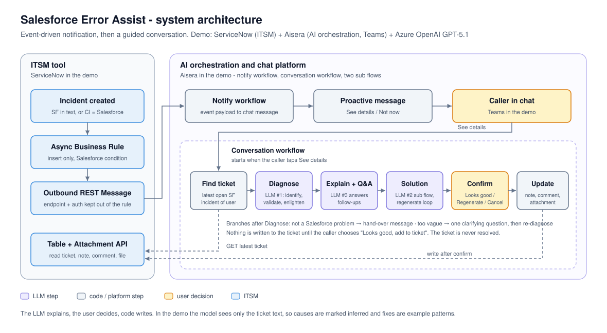

# Architecture



## Components

| Layer | Component | Responsibility | Demo implementation |
|---|---|---|---|
| ITSM | Trigger | Push an event when a Salesforce-related incident is created | ServiceNow async Business Rule + outbound REST Message |
| ITSM | Ticket API | Find the caller's latest open Salesforce incident, write the note, comment and attachment | ServiceNow Table API, Attachment API, Aisera *Update Ticket* action |
| ITSM | Configuration item | Lets tickets that never say "Salesforce" still be recognised | `cmdb_ci_appl` record named `Salesforce` |
| AI platform | Notify workflow | Turn the event into a proactive chat message with two buttons | Aisera workflow + proactive notification (Teams) |
| AI platform | Conversation workflow | Find the ticket, run the stages, hold the conversation, branch on the user's choices | Aisera workflow with User Input, Message, Branch, Prompt and JavaScript nodes |
| AI platform | Diagnose (LLM) | Identify, validate and explain the error in one call | Prompt Studio prompt (GPT-5.1) + JS parser |
| AI platform | Follow-up (LLM) | Answer the user's questions about the diagnosed error only | Prompt Studio prompt + JS parser |
| AI platform | Generate solution (LLM) | Fix pattern or steps, with a self-check, regenerated on feedback | Sub flow: Prompt Studio prompt + JS builder |
| AI platform | Update ticket (code) | Write the work note and comment, attach the code | Sub flow: JS + Update Ticket action + REST POST |

## Design principles

1. **The LLM explains, the user decides, code writes.** The prompts produce opinions and drafts. Nothing
   reaches the ticket until the user has seen the solution and confirmed it; the write itself is
   deterministic code.
2. **Two confirmations, then a reviewable write.** The user chooses to see the solution and chooses to
   add it. The ticket is never resolved and the note says *review before deploying*.
3. **Honest about its sources.** In the demo the model sees only the ticket text. Every likely cause is
   marked *inferred*, and every solution without source code is labelled an *example pattern*.
4. **Validate before explaining.** A ticket that isn't a Salesforce problem is handed back to the support
   team; a vague one gets exactly one clarifying question.
5. **Strings across every boundary.** Prompt inputs and outputs are strings, code nodes return one object,
   and every value the conversation branches on is a string such as `"true"`. This removes a whole class of
   type errors on low-code platforms.
6. **Identifiers in, content fetched.** The event carries only what the notification needs. The
   conversation re-reads the ticket from the ITSM API when the user taps the button.

## Data flow

```
ITSM: incident created (Salesforce in text, or CI = Salesforce)
  └─ async rule ──POST {sys_id, number, short_description, caller_email}──▶ AI platform event gateway
                                                     └─ Notify workflow ──▶ proactive message to the caller
                                                                              [See details] [Not now]
Caller taps See details
  └─ Conversation workflow
      ├─ Find ticket              ──GET latest open SF incident for this user──▶ ITSM
      ├─ Diagnose (LLM #1)        identify + validate + enlighten
      ├─ Branch                   not Salesforce → hand-over · vague → one question · else explain
      ├─ Explain + Ask a question (LLM #3, loop)
      ├─ Generate solution (LLM #2, sub flow; Regenerate loops here with feedback)
      ├─ Confirm                  Looks good / Regenerate / Cancel
      └─ Update ticket (sub flow) ──Update Ticket (note + comment), POST attachment──▶ ITSM
```

## Latency and cost

A typical conversation uses two LLM calls (diagnose, solution), plus one per follow-up question and one
per regeneration. Each prompt answered in roughly 5-10 seconds in the demo. ITSM traffic is one GET to
find the ticket and two writes at the end.
