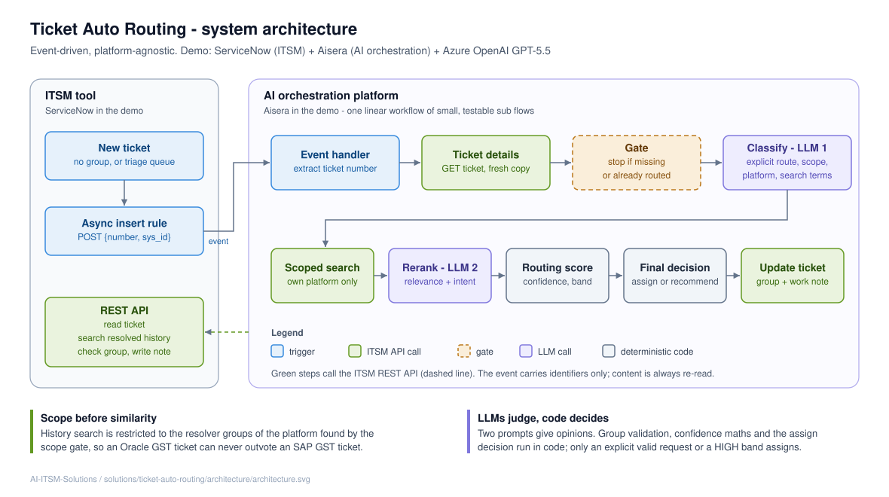

# Architecture



## Components

| Layer | Component | Responsibility | Demo implementation |
|---|---|---|---|
| ITSM | Trigger | Push an event when an unrouted ticket is created | ServiceNow async Business Rule + outbound REST Message |
| ITSM | Ticket API | Read the ticket, search resolved history, validate groups, write group and note | ServiceNow Table API (`incident`, `sys_user_group`) |
| AI platform | Event handler | Receive the event, extract the ticket number, start routing | Aisera event gateway + workflow |
| AI platform | Orchestrator | Run the fixed sequence and the single gate | Aisera main workflow |
| AI platform | Classify (LLM) | Explicit route, primary system, platform, search terms, charter group | Prompt Studio prompt (GPT-5.5) + JS plan node |
| AI platform | Search (code) | Platform-scoped history search, merge, de-duplicate | Two REST GETs + JS nodes |
| AI platform | Rerank (LLM) | Relevance and intent match per candidate | Prompt Studio prompt + JS parser |
| AI platform | Score (code) | Confidence, margin, band | JS node |
| AI platform | Decide and write (code) | Assign or recommend, compose the note, update the ticket | JS node + REST GET/PATCH |
| Optional | Chat agent | On-demand "Route INC…" from chat, using the same sub flows | Aisera Hyperflow |

## Design principles

1. **LLMs judge, code decides.** The two prompts give opinions: what system, what search terms, how
   similar. Assigning, confidence maths, group validation and query building are all code.
2. **Scope before similarity.** History search is restricted to the platform's resolver groups before
   any similarity is measured. This is the specific fix for cross-platform false matches.
3. **Allow-listed groups only.** No group name from a model or from ticket text is used unless it
   matches the configured list for that platform.
4. **Assign only on strong evidence.** Only an explicit valid request or a HIGH band assigns.
   Everything else becomes a recommendation in a note, and the ticket stays with the human triager.
5. **Every run leaves a trace.** One structured work note per run, including runs that don't route.
6. **Idempotent and linear.** The gate makes re-runs safe. Steps are linear sub flows, each testable on
   its own, and "skip" is handled by data rather than branches.
7. **Identifiers in, content fetched.** The event carries only the ticket number. Content is always
   read fresh from the ITSM API.

## Data flow

```
ITSM: ticket created in triage
  └─ async rule ──POST {incident_number, sys_id}──▶ AI platform event gateway
                                                      └─ Event Handler
                                                          └─ Main workflow
                                                              ├─ Ticket Details      ──GET──▶ ITSM
                                                              ├─ Gate (found, unassigned?)
                                                              ├─ Classify  (LLM #1 + plan)
                                                              ├─ Search Similar      ──GET x2──▶ ITSM (resolved, scoped)
                                                              ├─ Rerank    (LLM #2 + parser)
                                                              ├─ Routing Score (code)
                                                              ├─ Final Decision (code)
                                                              └─ Ticket Assignation  ──GET group, PATCH──▶ ITSM
```

## Latency and cost

Each ticket uses two LLM calls and five REST calls. In the demo, a newly created ticket was routed
within about a minute of saving, including the async rule's queue time.
