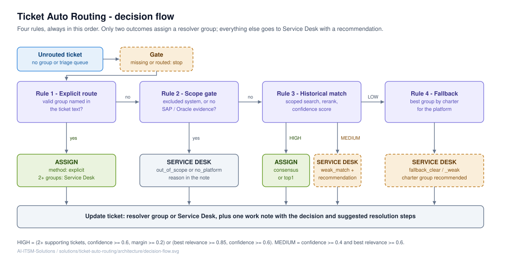

# Solution flow



Routing runs the same four rules, in this order, on every ticket. Each rule either decides or hands
over to the next one. Two LLM calls are used per ticket: **Classify** (Rules 1, 2 and the fallback
pick) and **Rerank** (Rule 3). Everything else, including the confidence maths and whether to assign,
is deterministic code.

## 0. Intake and gate

- The ITSM tool pushes an event when a ticket is created **unrouted**: either with no group, or in the
  landing queue (`AI Triage` in the demo).
- The workflow re-reads the ticket through the ITSM API. Event payloads are never trusted for content.
- Gate: stop if the ticket doesn't exist or is already in a real group. Re-running the workflow on a
  routed ticket is therefore always safe.

## Rule 1 - Explicit routing

The caller asked for a specific group ("assign to GD-SD-SAP-FICO", "please route to …").

- It only counts if the name matches the **allow-list** of routable groups, after normalising case,
  spaces and hyphens. "Assign to the SAP MM team" is not a valid group, so it falls through to Rule 2.
- People mentioned as context ("Suresh already looked at it", "manager approved") are not routing
  instructions.
- Two or more valid groups requested → `explicit_conflict`: nothing is assigned and both groups are
  listed in the note.

**Outcome:** assign (`explicit`).

## Rule 2 - Scope gate

**2A. Exclusionary systems.** The LLM identifies the *primary* system: where the failure happens or
where the change must be made. A system that is only mentioned for comparison or as a data source is
secondary.

| Ticket | Primary | Result |
|---|---|---|
| "Salesforce CPQ quote locked; SAP customer number field greyed out" | Salesforce | excluded |
| "Invoice wrong in SAP; Salesforce shows the correct price" | SAP | continue |
| "Delivery notes from SAP stuck in SP01" (spool) | SAP | continue (not printer hardware) |

**Outcome when excluded:** not routed (`out_of_scope`). The ticket stays in triage with a note.

**2B–2E. Platform.** The platform (SAP / Oracle / QAD / none) is decided from verbatim evidence only:
transaction codes, SAP objects, runtime errors and message numbers, Oracle concurrent programs and so
on. Generic words like *invoice*, *GST*, *report* or *payment* are not evidence on their own.

**Outcome when no platform:** not routed (`no_platform`).

## Rule 3 - Historical match

This is where the earlier similarity-only router went wrong. On an SAP GST report ticket it pulled four
Oracle GST tickets as "similar", because they shared the words *GST*, *invoice* and *report*. Consensus
failed and the ticket fell through to fallback rules. The fix has three parts.

**3a. Search terms (LLM → code).** The classifier proposes:
- *anchors*: exact identifiers where the problem happens (`ZSTR_GST`, `F5 201`,
  `TSV_TNEW_PAGE_ALLOC_FAILED`). A transaction the user only used to look something up (for example
  "visible in VF03") is not an anchor.
- *keywords*: 1–2 word symptom phrases plus resolver synonyms (`GSTR-1`, `posting period`, `GSTIN`).

Code then drops generic words, document numbers and long phrases, and builds the query clauses. The
model never writes query syntax.

**3b. Scoped retrieval (code).** Two searches run against **resolved** tickets, **restricted to the
groups of the platform from Rule 2**: one on anchors, one on keywords. The results are merged and
de-duplicated, with up to 15 candidates. Once Rule 2 says SAP, an Oracle ticket can never be a
candidate.

**3c. Rerank (LLM).** For every candidate, the model judges:
- *relevance* 0–1, where 0.9 or more means same object and same symptom, so the same fix would apply;
- *intent_match*: would the same team, doing the same kind of work, resolve it? This uses the
  candidate's close notes, which describe what was actually done.

**3d. Confidence (code).** Per candidate group:

```
weight(ticket)   = relevance
                   x 0.6  if the ticket was reassigned before (it bounced, so it's weaker evidence)
                   x 1.2  if it matched on an exact anchor
group score      = sum of weights of tickets with intent_match = true and relevance >= 0.5
confidence       = top group score / sum of all group scores
margin           = (top - second) / sum of all group scores
```

| Band | Condition | Action |
|---|---|---|
| HIGH (`consensus`) | >= 2 supporting tickets, confidence >= 0.6, margin >= 0.2 | assign |
| HIGH (`top1`) | best relevance >= 0.85 and confidence >= 0.6 | assign |
| MEDIUM (`weak_match`) | confidence >= 0.4 and best relevance >= 0.6 | recommend only |
| LOW | anything else | Rule 4 |

`top1` exists because some problems have exactly one strong historical twin. For example, the
`ZSTR_GST` ticket's only match is a previous `ZSTR_GST` ticket, and that is enough.

Safety check: an assigned group must belong to the platform decided in Rule 2.

## Rule 4 - Fallback by charter

The classifier has already picked the best group from the **group charters** (one-line descriptions
of what each team owns) for the identified platform. Exclusion checks run first: login, password or
T-code access → Security; firefighter or SoD → GRC; audit evidence → ITGC; dumps, jobs, transports,
spool → Basis; IDoc or EDI → Integration.

**Outcome:** recommend only (`fallback_clear` or `fallback_weak`). Fallback never auto-assigns in this
design.

## Output: one work note per decision

```
[AI Routing] Decision: ASSIGNED to GD-SD-SAP-SD
Method: top1
Confidence: 1 (HIGH)
Platform: SAP | Primary system: SAP
Explicit route: none | Exclusion: none
Evidence: INC0014610 (0.95)
Reason: Similar resolved tickets were handled by GD-SD-SAP-SD.
```

Every run writes exactly one note, including runs that don't assign anything. A recommended ticket stays
in the triage queue with the AI's suggestion visible to the human triager.

## What is AI and what is code

| Step | LLM | Code |
|---|---|---|
| Explicit route, primary system, platform | judges | validates groups against the allow-list |
| Search terms | proposes | filters, builds the query, scopes it to the platform |
| Similar ticket relevance | judges | discards numbers that weren't retrieved |
| Confidence, band, assign or not | - | all |
| Fallback group | proposes | validates against the platform's groups |
| Work note | - | template, ASCII only |
